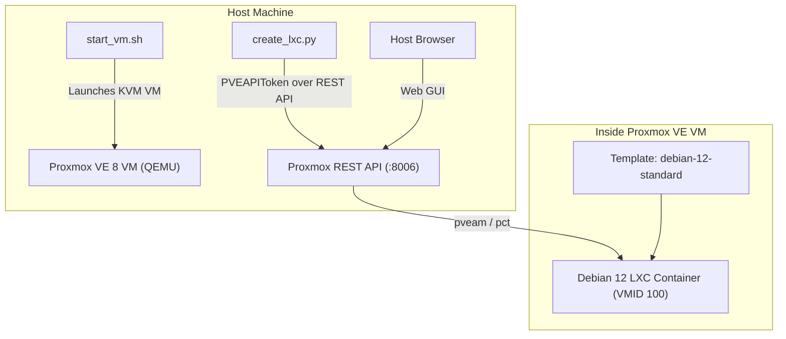

# lxctest - Proxmox VE VM & LXC Container Automation

Automated provisioning of a local **Proxmox VE 8** virtual machine (using QEMU/KVM) and declarative management of unprivileged **Debian 12 LXC containers** via the Proxmox REST API using Python.

---

## Architecture Overview



---

## Port Mappings & Access Points

The Proxmox VE VM runs locally with KVM acceleration and user-mode networking. Ports forwarded to your host machine:

| Service | Host URL / Address | Credentials |
|---|---|---|
| **Proxmox Web UI** | [https://localhost:8006](https://localhost:8006) | User: `root`, Realm: `Linux PAM` |
| **Proxmox REST API** | `https://localhost:8006/api2/json` | Authenticated via `PVEAPIToken` in `.env` |
| **SSH to Proxmox Host** | `ssh -p 2222 root@localhost` | User: `root` |
| **VNC Fallback Display** | `127.0.0.1:5900` | (Accessible via `remote-viewer vnc://127.0.0.1:5900`) |

---

## Directory Structure

```
/home/ilay/projects/lxctest/
├── .venv/                 # Python virtual environment
├── images/                # VM disk image (pve-disk.qcow2) and ISO
├── .env                   # Proxmox API token credentials (active)
├── .env.example           # Example environment template
├── config.yaml            # Container specification (active)
├── config.example.yaml    # Example container configuration
├── create_lxc.py          # Proxmox REST API container automation script
├── setup_pve.py           # Helper script to configure API token & download templates
├── start_vm.sh            # Script to boot the Proxmox VE VM
├── requirements.txt       # Python dependencies
├── PLAN.md                # Detailed step-by-step implementation plan
└── README.md              # Documentation (this file)
```

---

## Quickstart

### 1. Starting the Proxmox VE VM
To boot the Proxmox VM:
```bash
./start_vm.sh
```
*Note: If the VM is already installed, the script boots directly from `images/pve-disk.qcow2`.*

### 2. Activate Python Virtual Environment
```bash
source .venv/bin/activate
```

### 3. Container Management CLI (`create_lxc.py`)

#### Validate Configuration (Dry Run)
Verify API token, node health, and template availability without altering state:
```bash
python3 create_lxc.py --dry-run
```

#### Provision Container (from Base or Custom Docker Template)
Creates and boots an LXC container based on `config.yaml`:
```bash
python3 create_lxc.py
```

#### Custom Docker Template (`debian-12-docker.tar.zst`)
A custom Proxmox appliance template has been built and registered under `local:vztmpl/debian-12-docker.tar.zst`:
* **Docker Engine & containerd:** Pre-installed and systemd-enabled.
* **Pre-cached Images:** `nginx:alpine` and `alpine:latest` pre-loaded in local Docker storage.
* Any container created with this template in `config.yaml` boots up with Docker and cached images ready to use instantly.

To bake a new custom template from any running container:
```bash
python3 create_docker_template.py
```

#### Check Container Status
```bash
python3 create_lxc.py --status 100
```

#### Start, Stop, or Destroy Containers
```bash
python3 create_lxc.py --start 100
python3 create_lxc.py --stop 100
python3 create_lxc.py --destroy 100
```

---

## Accessing Container TTY Shells

Connect directly to any container's root shell from your host machine:

```bash
# Enter base Debian container (VMID 100)
ssh -p 2222 -t root@localhost "pct enter 100"

# Enter Docker container host (VMID 101)
ssh -p 2222 -t root@localhost "pct enter 101"
```

Inside Container 101, you can interact directly with Docker:
```bash
docker ps
docker logs web-nginx
docker exec -it web-nginx sh
```

---

## Direct Console Commands (inside Proxmox VE)

To inspect or interact with containers directly over SSH:
```bash
ssh -p 2222 root@localhost

# Check container status
pct status 100

# Execute commands inside container
pct exec 100 -- cat /etc/os-release
pct exec 100 -- ip a

# Enter container shell
pct enter 100
```

---

## Declarative Configuration (`config.yaml`)

Container resources are configured declaratively in `config.yaml`:

```yaml
proxmox:
  node: "pve"                  # Proxmox node name
  storage: "local-lvm"         # Storage pool for root disk
  template_storage: "local"    # Storage holding .tar.zst templates

container:
  vmid: null                   # null = auto-allocate next available ID
  hostname: "debian12-lxc"
  ostemplate: "debian-12-standard_12.12-1_amd64.tar.zst"
  description: "Debian 12 container managed via lxctest automation"
  cores: 2                     # CPU cores
  memory: 2048                 # RAM in MB
  swap: 512                    # Swap in MB
  disk_size: "16G"             # Rootfs size
  unprivileged: true           # Unprivileged container (recommended)
  nesting: true                # Enable systemd / Docker nesting
  start_after_create: true
  ssh_public_key: ""           # Optional path to public SSH key

network:
  interface: "eth0"
  bridge: "vmbr0"
  ip: "dhcp"
  gateway: ""
  firewall: true
```
