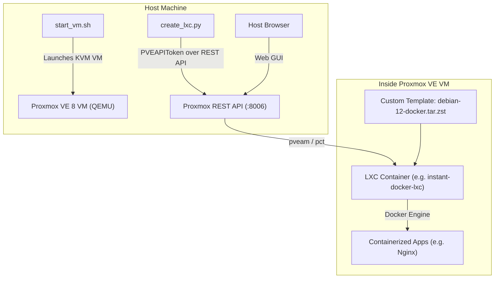

# lxc-ecosystem - Proxmox VE VM & LXC Container Automation

Automated provisioning of a local **Proxmox VE 8** virtual machine (using QEMU/KVM) and declarative management of unprivileged **Debian 12 LXC containers** via the Proxmox REST API using Python.

---

## Architecture Overview



---

## Port Mappings & Access Points

The Proxmox VE VM runs locally with KVM acceleration and user-mode networking. Ports forwarded to your host machine:

| Service | Host URL / Address | Credentials |
|---|---|---|
| **Proxmox Web UI** | [https://localhost:8006](https://localhost:8006) | User: `root`, Realm: `Linux PAM` |
| **Proxmox REST API** | `https://localhost:8006/api2/json` | Authenticated via `PVEAPIToken` in `.env` |
| **SSH to Proxmox Host** | `ssh -p 2222 root@localhost` | User: `root` (or key `id_pve`) |
| **VNC Fallback Display** | `127.0.0.1:5900` | (Accessible via `remote-viewer vnc://127.0.0.1:5900`) |

---

## Directory Structure

```
lxc-ecosystem/
├── images/                   # VM disk image (pve-disk.qcow2) and ISO (git ignored)
├── .env.example              # Credentials & SSH config template
├── config.example.yaml       # Example container specification
├── config.yaml               # Active container specification
├── create_lxc.py             # Main CLI: Proxmox REST API container automation
├── create_docker_template.py # Creates custom .tar.zst template with pre-cached Docker images
├── provision_docker_lxc.py   # Full pipeline to build Docker LXC from base template
├── pve_utils.py              # Shared SSH and execution helpers
├── setup_pve.py              # One-time initialization script (API token + template download)
├── start_vm.sh               # Boots Proxmox VE in QEMU/KVM with user port forwards
├── requirements.txt          # Python dependencies
├── PLAN.md                   # Step-by-step implementation plan
└── README.md                 # Full documentation
```

---

## Quickstart

### 1. Starting the Proxmox VE VM
To boot the Proxmox VM:
```bash
./start_vm.sh
```
*Note: If the VM is already installed, the script boots directly from `images/pve-disk.qcow2`.*

### 2. Activate Python Virtual Environment
```bash
source .venv/bin/activate
```

### 3. Container Management CLI (`create_lxc.py`)

#### Validate Configuration (Dry Run)
Verify API token, node health, and template availability without altering state:
```bash
python3 create_lxc.py --dry-run
```

#### Provision Container (from Base or Custom Docker Template)
Creates and boots an LXC container based on `config.yaml`:
```bash
python3 create_lxc.py
```

#### Check Container Status
```bash
python3 create_lxc.py --status 100
```

#### Start, Stop, or Destroy Containers
```bash
python3 create_lxc.py --start 100
python3 create_lxc.py --stop 100
python3 create_lxc.py --destroy 100
```

---

## Running Docker Inside Proxmox LXC

This project provides end-to-end support for running Docker Engine and containerized applications inside **unprivileged Debian 12 LXC containers**.

### Technical Requirements for Docker in LXC
Running Docker inside unprivileged LXC containers in Proxmox VE requires specific configuration:
1. **`nesting=1`**: Enables nested container namespaces and cgroup delegation so Docker can spawn child containers.
2. **`keyctl=1`**: Enables kernel key management inside unprivileged namespaces (required by Docker/systemd).
3. **`lxc.apparmor.profile: unconfined`**: Overrides default AppArmor restrictions that block `runc` from configuring network sysctls (such as `net.ipv4.ip_unprivileged_port_start`).

> [!NOTE]
> All automation scripts in this repository (`create_lxc.py`, `provision_docker_lxc.py`) configure these settings automatically.

---

### Two Ways to Deploy Docker LXC

#### 1. Instant Deployment via Pre-baked Template (Recommended)
A custom appliance template [`local:vztmpl/debian-12-docker.tar.zst`](file:///var/lib/vz/template/cache/debian-12-docker.tar.zst) is registered in Proxmox storage. It contains:
* Pre-installed Docker CE, containerd, and Docker Compose plugin.
* Docker service pre-enabled on systemd boot.
* Pre-cached Docker images: `nginx:alpine` and `alpine:latest`.

**Deploy in seconds:**
1. Set the template in `config.yaml`:
   ```yaml
   container:
     vmid: null                          # auto-allocates next ID (e.g. 103)
     hostname: "my-docker-app"
     ostemplate: "debian-12-docker.tar.zst"
   ```
2. Provision with the CLI:
   ```bash
   python3 create_lxc.py
   ```
The container boots with the `docker0` bridge active and images ready to launch offline without downloading anything.

---

#### 2. Fresh Installation from Scratch (`provision_docker_lxc.py`)
To build a Docker LXC from a standard minimal Debian 12 template:
```bash
python3 provision_docker_lxc.py
```
This script:
* Provisions an LXC container (`VMID 101`).
* Configures `nesting=1`, `keyctl=1`, and AppArmor unconfined.
* Adds Docker’s official Debian repository and GPG keys.
* Installs `docker-ce`, `docker-ce-cli`, `containerd.io`, and Docker Compose.
* Starts an `nginx:alpine` container on port 80 and verifies connectivity.

---

### Creating Your Own Custom Docker Templates

You can bake any container (with its installed packages and cached Docker images) into a reusable Proxmox template:

```bash
python3 create_docker_template.py --vmid 101 --name debian-12-custom.tar.zst --images nginx:alpine redis:alpine
```

**How it works under the hood:**
1. Connects to Proxmox VE via SSH.
2. Pulls requested Docker images inside the source container.
3. Cleans temporary files, package caches, bash history, and truncates `/etc/machine-id` (so every spawned container receives a unique identity).
4. Streams a rootfs archive from inside the container (preserving standard `0:0` UID/GID ownership) directly into `zstd` compression on the Proxmox host.
5. Saves the `.tar.zst` into `/var/lib/vz/template/cache/`, making it instantly selectable in `pveam` and `config.yaml`.

---

## Interacting with Docker Containers

### Connect to LXC Shell (TTY)
```bash
# Connect to your Docker container host
ssh -p 2222 -t root@localhost "pct enter 103"
```

### Run Docker Commands Inside LXC
Once inside the container shell:
```bash
# Check Docker daemon status & pre-cached images
docker info
docker images

# Run a container from the pre-cached image
docker run -d --name web -p 80:80 nginx:alpine

# Verify running container & test HTTP
docker ps
curl -I http://localhost:80

# Execute commands inside the Docker container
docker exec -it web sh
```

---

## Direct Console Commands (inside Proxmox VE)

To inspect or interact with containers directly over SSH:
```bash
ssh -p 2222 root@localhost

# Check container status
pct status 100

# Execute commands inside container
pct exec 100 -- cat /etc/os-release
pct exec 100 -- ip a

# Enter container shell
pct enter 100
```

---

## Declarative Configuration (`config.yaml`)

Container resources are configured declaratively in `config.yaml`:

```yaml
proxmox:
  node: "pve"                  # Proxmox node name
  storage: "local-lvm"         # Storage pool for root disk
  template_storage: "local"    # Storage holding .tar.zst templates

container:
  vmid: null                   # null = auto-allocate next available ID
  hostname: "debian12-lxc"
  ostemplate: "debian-12-standard_12.12-1_amd64.tar.zst"
  description: "Debian 12 container managed via lxctest automation"
  cores: 2                     # CPU cores
  memory: 2048                 # RAM in MB
  swap: 512                    # Swap in MB
  disk_size: "16G"             # Rootfs size
  unprivileged: true           # Unprivileged container (recommended)
  nesting: true                # Enable systemd / Docker nesting
  start_after_create: true
  ssh_public_key: ""           # Optional path to public SSH key

network:
  interface: "eth0"
  bridge: "vmbr0"
  ip: "dhcp"
  gateway: ""
  firewall: true
```
